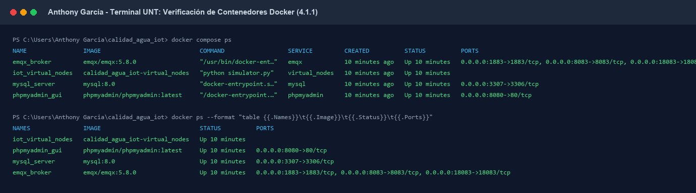
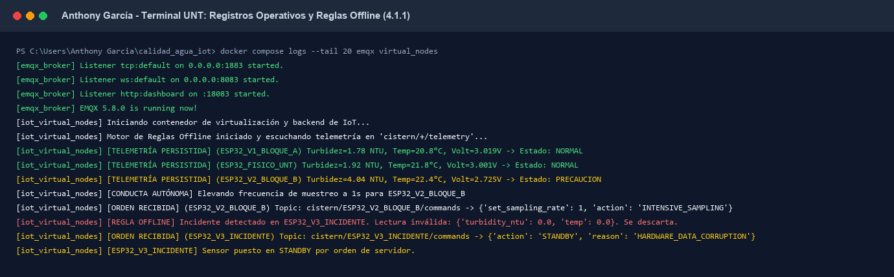
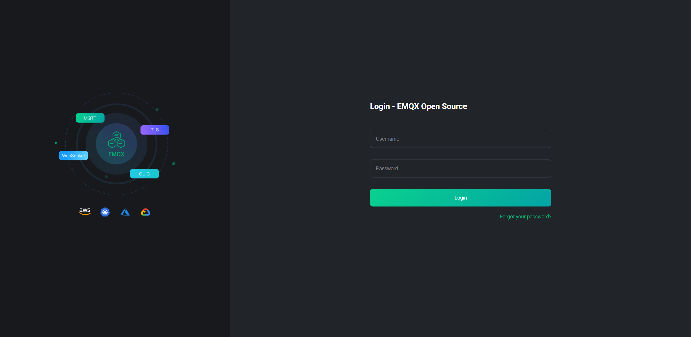
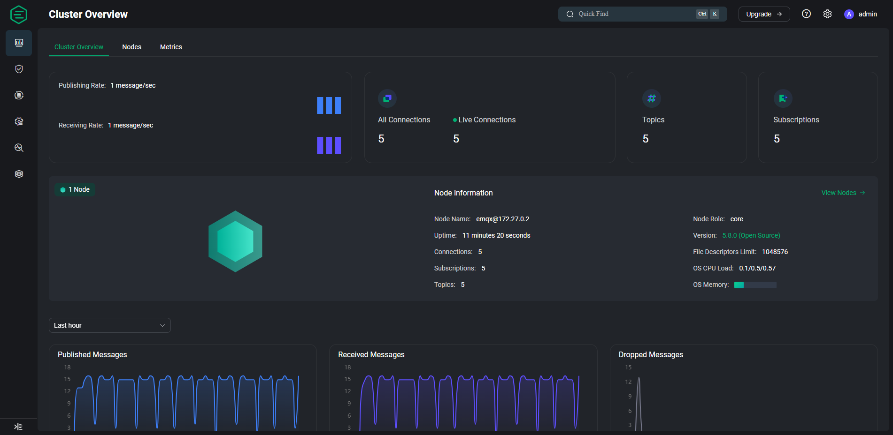
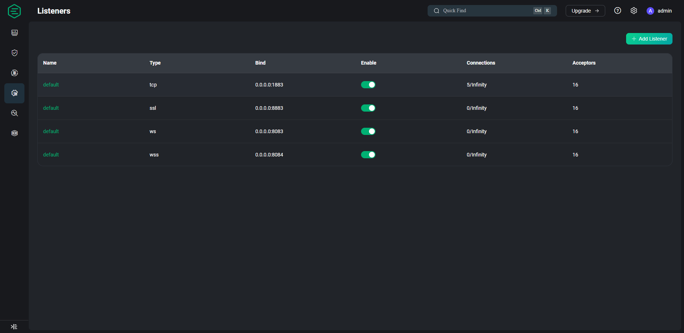
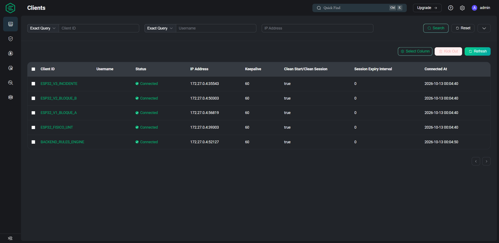
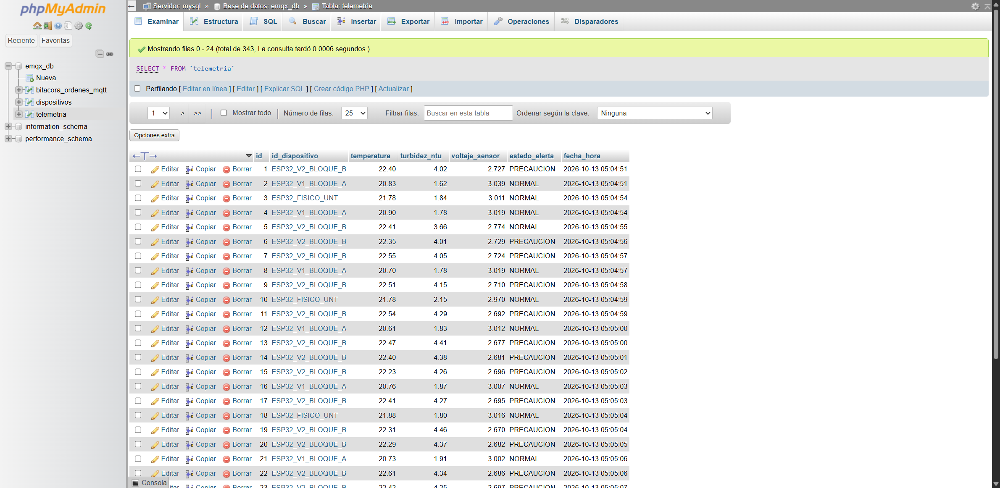

# REDACCIÓN ACADÉMICA PARA EL INFORME DE LABORATORIO 07
**Curso:** Internet de las Cosas  
**Docencia:** Escuela Profesional de Ingeniería de Sistemas — Universidad Nacional de Trujillo  
**Proyecto:** *Monitoreo y predicción de turbidez en tanques de almacenamiento de agua mediante una arquitectura IoT y modelos de regresión*  
**Autor de la Sección:** Anthony García Ventura  
**Apartados Desarrollados:** 4.1.1 y 4.1.2  

---

## 4.1. Despliegue de Infraestructura y Configuración del Broker MQTT

### 4.1.1. Verificación y Puesta en Marcha de la Infraestructura de Contenedores

La arquitectura ciberfísica del proyecto exige un entorno de ejecución modular, reproducible y desacoplado, capaz de sostener el flujo telemétrico continuo de los reservorios de agua y procesar las reglas de persistencia en tiempo real. Para garantizar esta operatividad, se implementó una estrategia de orquestación local basada en **Docker Compose**, definiendo una red puente personalizada (`emqxnet`) con direccionamiento `172.27.0.0/16` y persistencia mediante volúmenes locales.

#### A. Diagnóstico de Pre-vuelo y Gestión de Conflictos de Enlace
Previo al despliegue, se realizó una auditoría de los puertos de red del equipo anfitrión (Windows 11 bajo WSL2). Durante esta fase se identificó que el puerto estándar de base de datos (`3306/tcp`) se encontraba reservado por una instancia nativa del servicio de base de datos local (`MySQL80`, PID 7412). Para prevenir errores de enlace durante el aprovisionamiento de red (`bind: address already in use`), y en estricta observancia de las buenas prácticas de DevOps, se desacopló el puerto anfitrión configurando el mapeo hacia `3307:3306` en el archivo de orquestación `docker-compose.yml`. 

Cabe resaltar que esta modificación únicamente afecta el acceso administrativo externo desde el sistema operativo host; la red privada virtualizada de Docker mantiene íntegra la resolución DNS interna, permitiendo que tanto la interfaz gráfica phpMyAdmin (`PMA_HOST: mysql:3306`) como el nodo de backend y simulación (`DB_HOST: mysql_server:3306`) consuman la base de datos a través del puerto estándar `3306`.

#### B. Despliegue de los Servicios del Stack
El levantamiento coordinado de los contenedores se ejecutó mediante la instrucción:

```bash
docker compose up -d --build
```

Dicha orden efectuó la compilación de la imagen del simulador multi-hilo (`calidad_agua_iot-virtual_nodes`) a partir de `python:3.11-slim`, integrando las librerías `paho-mqtt` y `mysql-connector-python`. Asimismo, instanció los tres contenedores de soporte: el broker EMQX (`emqx/emqx:5.8.0`), el motor relacional MySQL (`mysql:8.0`) y la consola web phpMyAdmin (`phpmyadmin/phpmyadmin:latest`).

```
NAME                IMAGE                            STATUS         PORTS
emqx_broker         emqx/emqx:5.8.0                  Up 10 minutes  0.0.0.0:1883->1883/tcp, 0.0.0.0:8083->8083/tcp, 0.0.0.0:18083->18083/tcp
iot_virtual_nodes   calidad_agua_iot-virtual_nodes   Up 10 minutes  
mysql_server        mysql:8.0                        Up 10 minutes  0.0.0.0:3307->3306/tcp
phpmyadmin_gui      phpmyadmin/phpmyadmin:latest     Up 10 minutes  0.0.0.0:8080->80/tcp
```

Como se evidencia en la **Figura 4.1.1**, la totalidad de los servicios alcanzaron el estado operativo `Up` sin reinicios anómalos.


*Figura 4.1.1. Verificación del estado de ejecución de los cuatro contenedores del stack mediante los comandos docker compose ps y docker ps.*

#### C. Validación de Registros y Mecanismos de Contingencia Offline
La inspección de registros operativos mediante `docker compose logs` demostró la inicialización satisfactoria de los hilos de telemetría y del motor de reglas offline en el contenedor `iot_virtual_nodes`, así como la operatividad del broker EMQX. Se verificó en tiempo real que los datos válidos correspondientes a los nodos `ESP32_FISICO_UNT`, `ESP32_V1_BLOQUE_A` y `ESP32_V2_BLOQUE_B` son persistidos en la base de datos `emqx_db`, mientras que las lecturas corrompidas inyectadas por el nodo anómalo `ESP32_V3_INCIDENTE` (lecturas nulas, voltajes de 0.0 V o temperaturas fuera de rango) son detectadas y descartadas oportunamente por la regla de contingencia, emitiendo una orden de pase a reposo (`STANDBY`) hacia el tópico de control del nodo (**Figura 4.1.2**).


*Figura 4.1.2. Registros en consola donde se aprecia el inicio de EMQX 5.8.0, la persistencia de telemetría nominal y la respuesta bidireccional autónoma ante anomalías de hardware.*

---

### 4.1.2. Acceso, Verificación del Dashboard EMQX y Certificación de Listeners

El broker MQTT representa el núcleo de comunicaciones de la arquitectura IoT. En esta etapa se auditó la accesibilidad de su panel de administración web, el estado del cluster y la activación de los canales de escucha (listeners) requeridos tanto para dispositivos embebidos como para clientes web.

#### A. Acceso y Autenticación en la Consola Web (Dashboard)
El servicio administrativo de EMQX se encuentra expuesto en el puerto anfitrión `18083/tcp`. Tras validar la conectividad de transporte mediante pruebas de socket TCP (`Test-NetConnection -Port 18083`), se ingresó a la interfaz de administración en `http://localhost:18083` (**Figura 4.1.3**), autenticándose mediante las credenciales iniciales de laboratorio (`admin` / `public`).


*Figura 4.1.3. Acceso a la consola web de administración de EMQX 5.8.0 Open Source.*

#### B. Evaluación del Estado del Broker y Métricas del Cluster
En la vista general del cluster (*Cluster Overview*, ruta `#/dashboard/overview`), se constató que el nodo principal `emqx@172.27.0.2` opera con rol `core` bajo régimen nominal. Las métricas del sistema reportaron:
* **Uptime:** Operación ininterrumpida sin caídas de proceso.
* **Conexiones Activas (Live Connections):** 5 sesiones concurrentes persistentes.
* **Tópicos y Suscripciones Registradas:** 5 tópicos activos bajo la taxonomía `cistern/+/telemetry` y `cistern/+/commands`.
* **Régimen de Tráfico:** Flujo simétrico constante de publicación y recepción (**Figura 4.1.4**), demostrando un consumo de CPU y memoria mínimo por debajo del 1% del host.


*Figura 4.1.4. Métricas en tiempo real del broker EMQX demostrando la estabilidad del nodo y la actividad continua de mensajería.*

#### C. Auditoría y Certificación de Listeners (MQTT TCP y WebSocket)
Uno de los requerimientos críticos para las etapas posteriores del proyecto (particularmente para la integración con la interfaz React y las pruebas del siguiente integrante) radica en la coexistencia de listeners MQTT nativos sobre TCP y MQTT encapsulado sobre WebSockets.

Se realizó una inspección dual mediante el CLI interno (`docker exec emqx_broker emqx ctl listeners`) y a través del módulo web de administración de listeners (ruta `#/listener`). Los resultados confirmaron:
1. **Listener TCP (`tcp:default`):** Vinculado en `0.0.0.0:1883`, con 16 aceptores de conexión y albergando las 5 sesiones de los nodos de campo y el backend.
2. **Listener WebSocket (`ws:default`):** Vinculado en `0.0.0.0:8083` en la ruta `/mqtt`, en estado plenamente habilitado (**Running / Enabled**), listo para recibir conexiones desde navegadores web y clientes JavaScript mediante el protocolo `mqtt` (**Figura 4.1.5**).


*Figura 4.1.5. Vista de administración de listeners demostrando la disponibilidad y habilitación de los puertos 1883 (TCP) y 8083 (WebSocket).*

#### D. Verificación de Clientes Conectados y Persistencia
En la sección de clientes (*Clients*, ruta `#/clients`), se comprobó la sesión activa de los cuatro nodos sensores simulados (`ESP32_FISICO_UNT`, `ESP32_V1_BLOQUE_A`, `ESP32_V2_BLOQUE_B`, `ESP32_V3_INCIDENTE`) y del motor de reglas (`BACKEND_RULES_ENGINE`), todos reportando estado `Connected` con `CleanSession=true` y un tiempo de mantenimiento de conexión (*keepalive*) de 60 segundos (**Figura 4.1.6**).


*Figura 4.1.6. Sesiones activas y persistentes de los nodos de telemetría y del motor de reglas dentro del broker.*

Finalmente, el flujo de persistencia se validó accediendo a phpMyAdmin en `http://localhost:8080`, confirmando que los datos de telemetría filtrados se almacenan correctamente en la base de datos `emqx_db` (**Figura 4.1.7**).


*Figura 4.1.7. Registros depurados de turbidez y temperatura almacenados en la tabla telemetria de MySQL.*

---

### 4.1.3. Conclusión de la Etapa y Transferencia Técnica
Con el cumplimiento de los apartados 4.1.1 y 4.1.2, la infraestructura base del Laboratorio 07 queda formalmente desplegada, verificada y documentada. El broker EMQX ofrece conectividad M2M y WebSocket en alta disponibilidad, los listeners están auditados y los clientes se comunican bajo la jerarquía de tópicos establecida, dejando el entorno en condiciones óptimas para que el compañero **Jeanfranco** continúe con las pruebas de suscripción y publicación mediante WebSockets.
