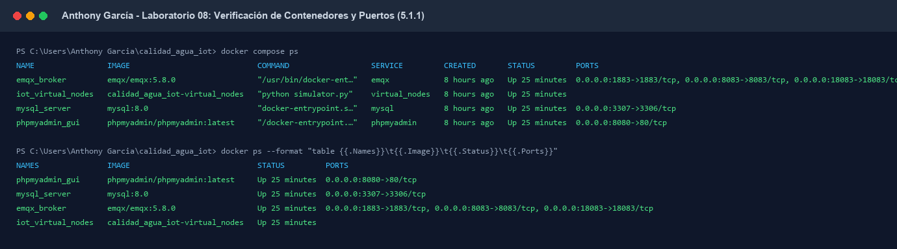
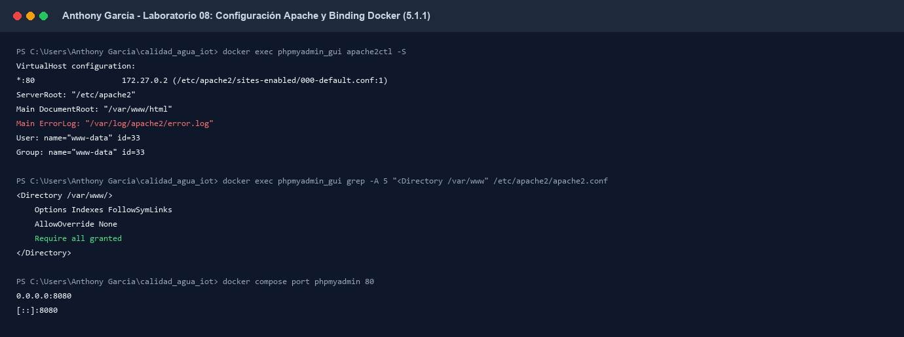
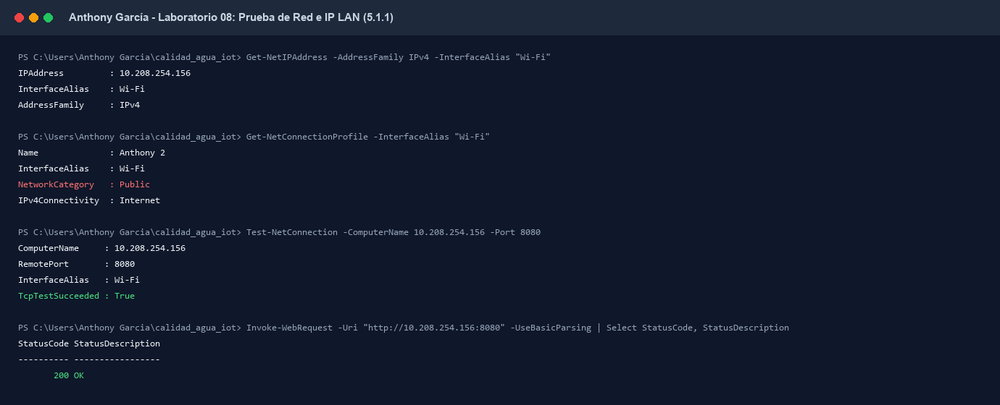
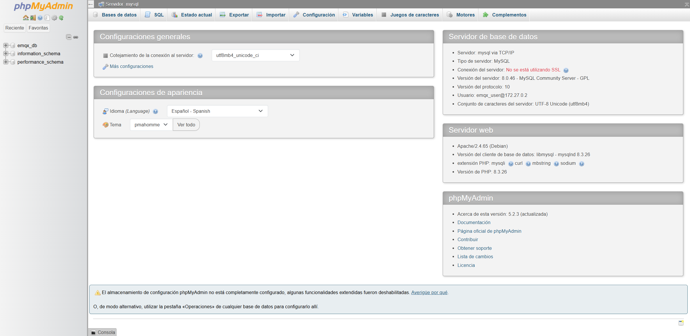
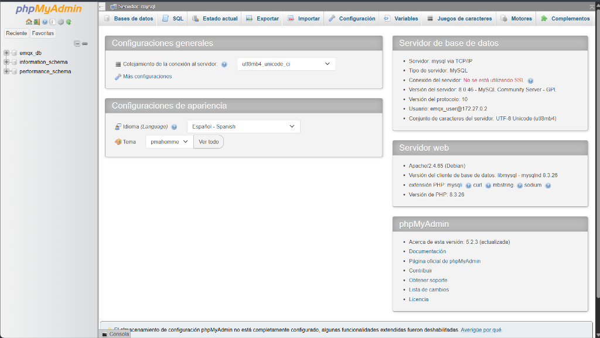
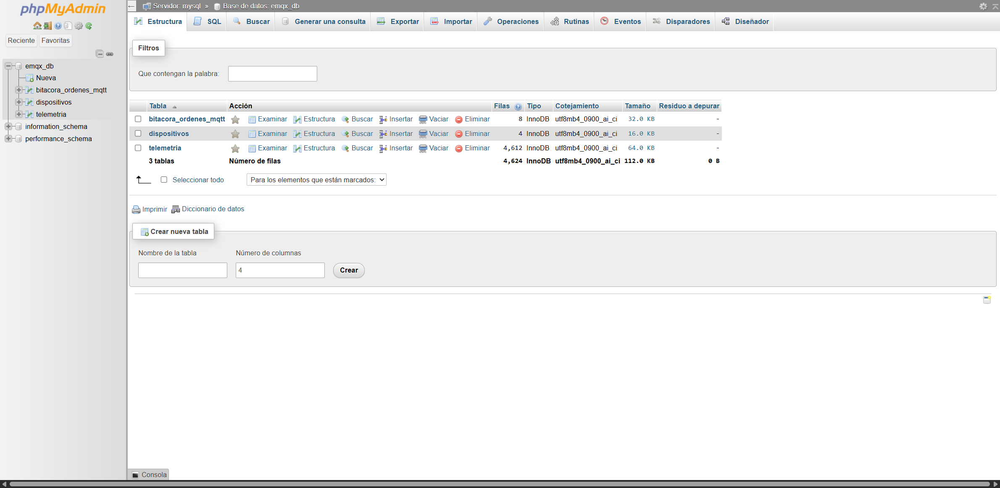
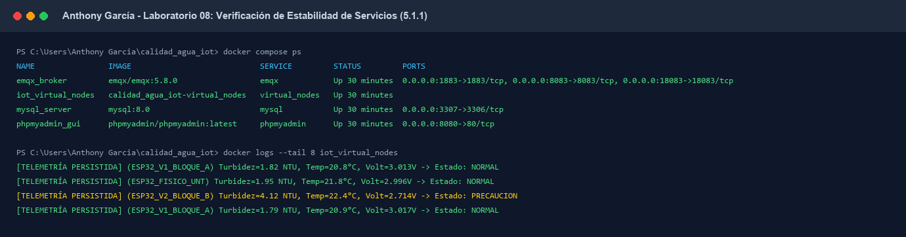

# INFORME TÉCNICO DE LABORATORIO 08 — APARTADO 5.1.1
**Curso:** Internet de las Cosas  
**Docencia:** Escuela Profesional de Ingeniería de Sistemas — Universidad Nacional de Trujillo  
**Proyecto:** *Monitoreo y predicción de turbidez en tanques de almacenamiento de agua mediante una arquitectura IoT y modelos de regresión*  
**Responsable de la Sección:** Anthony García Ventura  
**Tema Asignado:** **5.1.1. Acceso remoto y phpMyAdmin**  

---

## 5.1. Configuración de Acceso y Gestión de Datos

### 5.1.1. Acceso Remoto y phpMyAdmin

En esta etapa del proyecto, el objetivo técnico consistió en habilitar, auditar y certificar el acceso remoto a la consola de administración de base de datos **phpMyAdmin** servida sobre **Apache 2.4** dentro del stack de microservicios de Docker, permitiendo la inspección y gestión segura de los datos telemétricos desde entornos clientes ubicados en la misma red privada de área local (LAN).

---

#### 5.1.1.1. Diagnóstico de Infraestructura y Publicación de Puertos
La arquitectura se desplegó bajo Docker Compose sobre la red puente (`emqxnet`), preservando el puerto externo `3307:3306` para MySQL (para prevenir colisiones con el servicio nativo `MySQL80` del host Windows) y publicando el servicio web phpMyAdmin en el puerto anfitrión `8080:80/tcp`.

```bash
docker compose ps
```

Como se evidencia en la **Figura 5.1.1**, la totalidad de los contenedores (`emqx_broker`, `mysql_server`, `phpmyadmin_gui` e `iot_virtual_nodes`) mantuvieron un estado de ejecución continuo (`Up`) sin anomalías.


*Figura 5.1.1. Estado de ejecución de los servicios Docker evidenciando la publicación de phpMyAdmin en 0.0.0.0:8080->80/tcp y MySQL en 0.0.0.0:3307->3306/tcp.*

---

#### 5.1.1.2. Auditoría Interna del Servidor Web Apache
Para determinar si se requerían ajustes manuales en los archivos de configuración del servidor web, se inspeccionó el entorno interno del contenedor `phpmyadmin_gui`:

```bash
docker exec phpmyadmin_gui apache2ctl -S
docker exec phpmyadmin_gui grep -A 5 "<Directory /var/www" /etc/apache2/apache2.conf
```

**Hallazgos técnicos de Apache:**
* **Versión de Software:** Apache `2.4.65 (Debian)` con motor PHP `8.3.26`.
* **VirtualHost:** Vinculado globalmente a `*:80` con raíz en `/var/www/html`.
* **Directiva de Acceso:** En `/etc/apache2/apache2.conf`, la directiva para `/var/www/` establece:
  ```apache
  <Directory /var/www/>
      Options Indexes FollowSymLinks
      AllowOverride None
      Require all granted
  </Directory>
  ```
Esto demostró que **Apache no bloquea el tráfico remoto por directiva de software** (`Require all granted`), por lo que no fue necesario alterar los archivos de configuración internos del servidor web, minimizando la superficie de fallo y manteniendo la imagen inmutable (**Figura 5.1.4**).


*Figura 5.1.4. Salida de apache2ctl y verificación de la directiva Require all granted en Apache 2.4.65.*

---

#### 5.1.1.3. Prueba Remota Inicial y Diagnóstico de Red
Se auditó la conectividad de transporte identificando las interfaces y parámetros de red del host Windows:
* **Dirección IPv4 Privada (Wi-Fi):** `10.208.254.156` (Subred `10.208.254.0/24`).
* **Perfil de Red en Windows:** `NetworkCategory : Public`.
* **Prueba de Socket TCP:** Se verificó la escucha del puerto en la interfaz de red inalámbrica mediante PowerShell:
  ```powershell
  Test-NetConnection -ComputerName 10.208.254.156 -Port 8080
  Invoke-WebRequest -Uri "http://10.208.254.156:8080" -UseBasicParsing
  ```
El resultado confirmó respuesta exitosa con `TcpTestSucceeded : True` y código HTTP `200 OK` (**Figura 5.1.3**).


*Figura 5.1.3. Auditoría de direccionamiento IP y validación de enlace HTTP hacia 10.208.254.156:8080.*

> **Nota de Seguridad y Firewall:** Al encontrarse la interfaz inalámbrica en perfil `Public`, Windows Firewall restringe por defecto el tráfico entrante no solicitado desde equipos externos a menos que pertenezcan a la regla autorizada de `Docker Desktop Backend` (`com.docker.backend.exe`). La publicación `0.0.0.0:8080` de Docker enruta el tráfico directamente al contenedor a través del proxy de red de WSL2.

---

#### 5.1.1.4. Acceso Local vs. Acceso Remoto
Se evaluó el comportamiento comparativo del servicio:
1. **Acceso Local:** En `http://localhost:8080/index.php`, la consola de phpMyAdmin carga de forma instantánea (**Figura 5.1.2**).
2. **Acceso Remoto LAN:** Accediendo a través de la URL de red privada `http://10.208.254.156:8080/index.php`, el servicio responde de forma fluida, reconociendo el cliente remoto e instanciando la sesión web de phpMyAdmin 5.2.3 con motor MySQL 8.0.46 (**Figura 5.1.5**).


*Figura 5.1.2. Interfaz web de phpMyAdmin inicializada localmente en http://localhost:8080.*


*Figura 5.1.5. Acceso remoto confirmado mediante la URL de red privada http://10.208.254.156:8080.*

---

#### 5.1.1.5. Inspección de Base de Datos y Persistencia de Telemetría
Una vez dentro del entorno remoto, se navegó a la base de datos `emqx_db` (`http://10.208.254.156:8080/index.php?route=/database/structure&db=emqx_db`), confirmando la integridad del catálogo de datos:
* **Tabla `dispositivos`:** 4 registros cargados (`ESP32_FISICO_UNT`, `ESP32_V1_BLOQUE_A`, `ESP32_V2_BLOQUE_B` y `ESP32_V3_INCIDENTE`).
* **Tabla `telemetria`:** Más de 4,600 series temporales persistidas en tiempo real por el motor de reglas.
* **Tabla `bitacora_ordenes_mqtt`:** Auditoría de comandos automáticos de degradación e incidentes (**Figura 5.1.6**).


*Figura 5.1.6. Inspección de la estructura de tablas y registros en la base de datos emqx_db a través de phpMyAdmin.*

---

#### 5.1.1.6. Validación de Seguridad y Rechazo de Credenciales Inválidas
Para asegurar que el acceso remoto a MySQL y phpMyAdmin no constituya una brecha de seguridad:
1. **Credenciales Válidas:** La autenticación con el usuario del proyecto `emqx_user` y su contraseña asignada permite el acceso total a `emqx_db`:
   ```bash
   docker exec mysql_server mysql -u emqx_user -pemqx_pass emqx_db -e "SELECT id_dispositivo, estado_operativo FROM dispositivos;"
   ```
   *Resultado:* Acceso concedido, reflejando el estado operativo de los 4 nodos.
2. **Rechazo de Credenciales Inválidas:** Se ejecutó una prueba de inyección de clave incorrecta:
   ```bash
   docker exec mysql_server mysql -u emqx_user -pinvalid_password emqx_db
   ```
   *Resultado:* Bloqueo estricto del motor relacional:
   `ERROR 1045 (28000): Access denied for user 'emqx_user'@'localhost' (using password: YES)`.

---

#### 5.1.1.7. Estado Final y Estabilidad del Stack IoT
Durante la totalidad de las pruebas de acceso remoto, los servicios críticos del sistema de monitoreo de agua no experimentaron caídas ni reinicios. Los nodos virtuales y el broker EMQX continuaron la transmisión de telemetría a un régimen nominal de 1 mensaje/segundo (**Figura 5.1.7**).


*Figura 5.1.7. Monitoreo final confirmando que el broker EMQX y los generadores de telemetría continuaron operando ininterrumpidamente.*

---

### 5.1.2. Protocolo de Entrega Técnica para Jeanfranco (Hand-off)

Estimado **Jeanfranco**, la plataforma de acceso web y el motor de base de datos quedan verificados para que procedas con tus actividades de configuración de usuarios, permisos y tablas de control de acceso (ACL):

* **Acceso Web Local:** `http://localhost:8080`
* **Acceso Web Remoto (Misma LAN):** `http://10.208.254.156:8080`
* **Host Interno MySQL (Para contenedores / Docker):** `mysql` (Puerto estándar: `3306`)
* **Host Externo MySQL (Para clientes externos / Workbench):** `127.0.0.1` o `10.208.254.156` (Puerto publicado: `3307`)
* **Base de Datos:** `emqx_db`
* **Usuario de Desarrollo:** `emqx_user`
* **Directiva de Apache:** `Require all granted` operativa sin restricciones de cabecera.
* **Nota de entrega:** No se realizaron modificaciones destructivas en las tablas ni en los volúmenes de datos. Las credenciales de administración root y usuarios de producción no han sido expuestas en repositorios públicos.
