# REDACCIÓN ACADÉMICA PARA EL INFORME DE LABORATORIO 08
**Curso:** Internet de las Cosas  
**Docencia:** Escuela Profesional de Ingeniería de Sistemas — Universidad Nacional de Trujillo  
**Proyecto:** *Monitoreo y predicción de turbidez en tanques de almacenamiento de agua mediante una arquitectura IoT y modelos de regresión*  
**Autor de la Sección:** Jeanfranco  
**Apartados Desarrollados:** 5.1.2 y 5.1.3

---

### 5.1.2. Habilitación de MySQL para conexiones requeridas

#### 5.1.2.1. Estado del servicio

El servicio de base de datos del Laboratorio 08 corresponde al contenedor `mysql_server` del archivo de orquestación Docker Compose del proyecto, definido con la imagen oficial `mysql:8.0` y una publicación de puertos de `3307` (host) hacia `3306` (contenedor). Durante la inspección inicial se confirmó que los cuatro contenedores del ecosistema (`emqx_broker`, `mysql_server`, `phpmyadmin_gui` e `iot_virtual_nodes`) permanecían en estado *Up*, sin necesidad de reinicios. La versión real del servidor se verificó con el cliente incluido en la imagen: MySQL 8.0.46 Community Server (GPL) para Linux x86_64 (**Figura 1**).

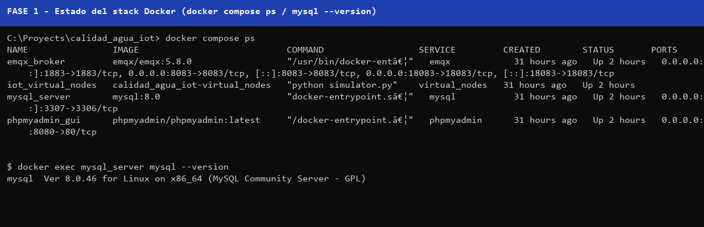
*Figura 1. Estado del servicio MySQL y puertos publicados (salida de `docker compose ps` y `mysql --version`).*

#### 5.1.2.2. Puerto y configuración de red

La publicación del puerto se verificó con `docker compose port mysql 3306`, que devolvió `0.0.0.0:3307`, indicando que el puerto interno 3306 del contenedor está expuesto en todas las interfaces del anfitrión en el puerto 3307. Del lado del servidor, las variables de sistema `bind_address` y `port` reportaron `*` y `3306` respectivamente (**Figura 2**), configuración que resulta correcta dentro de la red Docker `emqxnet` y que no requirió modificaciones. Es preciso distinguir dos planos de acceso: desde la máquina anfitriona, el servidor se alcanza como `localhost:3307`; desde cualquier otro contenedor de la misma red —incluido EMQX—, el nombre resoluble es `mysql_server` (alias de servicio `mysql`) en el puerto interno `3306`. Esta diferencia es determinante para la posterior configuración del autenticador MySQL de EMQX.

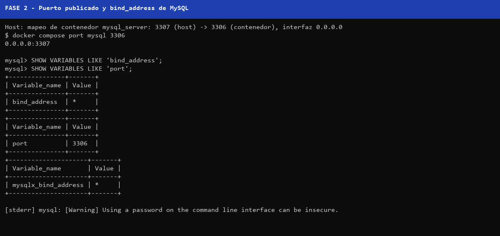
*Figura 2. Configuración de red del servidor MySQL (mapeo de puerto y variables `bind_address`/`port`).*

#### 5.1.2.3. Verificación del acceso

Se comprobó el acceso por dos vías: (a) de forma interna al contenedor como `root@localhost`, obteniendo la versión 8.0.46; y (b) desde la máquina anfitriona mediante el usuario del proyecto `emqx_user` sobre `127.0.0.1:3307`, con sesión resuelta como `emqx_user@172.18.0.1` y base activa `emqx_db` (**Figura 3**). Ambas pruebas se ejecutaron sin exponer credenciales en los comandos registrados.

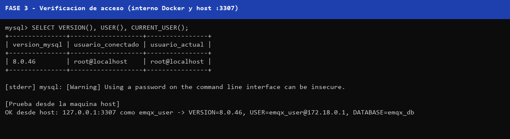
*Figura 3. Verificación del acceso a MySQL desde el interior de Docker y desde la máquina anfitriona.*

### 5.1.3. Base de datos para autenticación y ACL

#### 5.1.3.1. Inspección de la base existente

La inspección de solo lectura reveló la existencia de la base `emqx_db` —declarada como `MYSQL_DATABASE` en la orquestación— con las tablas de negocio del proyecto: `dispositivos`, `telemetria` y `bitacora_ordenes_mqtt`, cuyas estructuras se describieron sin modificarlas y cuyos conteos (4 dispositivos, más de 13 000 registros de telemetría y 8 órdenes) confirman el flujo activo del motor de reglas. La búsqueda de tablas de autenticación existentes localizó únicamente los esquemas `mqtt_auth_user` y `mqtt_auth_acl` pertenecientes a `lab07_prep`, preparación previa del Laboratorio 07. Se decidió entonces utilizar **`emqx_db`** como base de autenticación y autorización (**Figura 4**), por ser la base del proyecto, estar bajo la propiedad de `emqx_user` y ofrecer un único punto de configuración para la etapa de Daniel; el esquema `lab07_prep` se conservó sin eliminarse, quedando en desuso documentado.

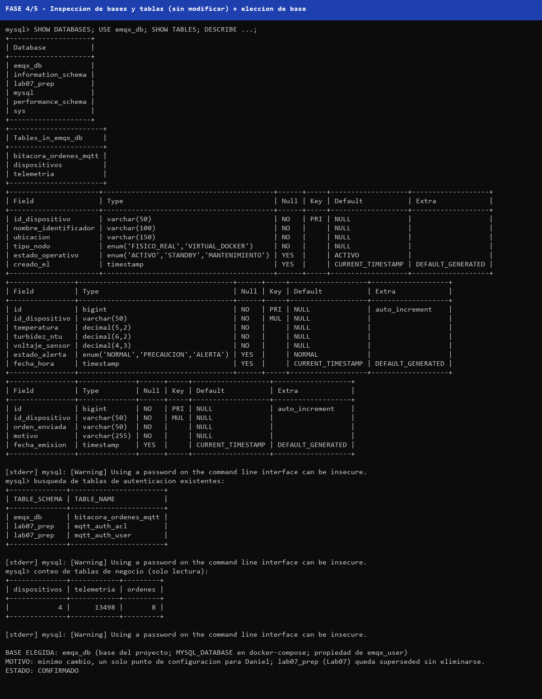
*Figura 4. Base de datos utilizada para autenticación y autorización (`emqx_db`) junto con la inspección de tablas existentes.*

#### 5.1.3.2. Preparación de la tabla de autenticación

Siguiendo la documentación oficial de EMQX 5.x para integración con MySQL —la cual admite esquemas personalizados siempre que la consulta devuelva `password_hash`, `salt` opcionalmente e `is_superuser` opcionalmente—, se creó la tabla `mqtt_user` mediante `CREATE TABLE IF NOT EXISTS` con clave primaria autoincremental, restricción `UNIQUE` sobre `username` (índice `mqtt_username`) y las columnas `password_hash`, `salt`, `is_superuser`, `enabled` y `created` (**Figura 5**). Se optó por el algoritmo **bcrypt**, nativo de la cadena de autenticación de EMQX 5.8, descartando MD5/SHA simples heredados de guías antiguas; al incorporar bcrypt su propio salt, la columna `salt` permanece en NULL.

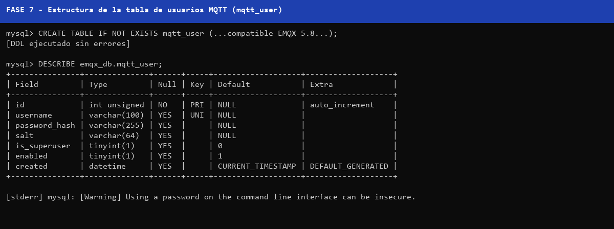
*Figura 5. Estructura de la tabla de usuarios MQTT (`mqtt_user`).*

#### 5.1.3.3. Preparación de la tabla de autorización

De manera anáoga, y alineados con el ejemplo de esquema del autorizador MySQL oficial, se creó la tabla `mqtt_acl` con columnas `ipaddress`, `username`, `clientid`, `action` (enum `publish`/`subscribe`/`all`), `permission` (enum `allow`/`deny`), `topic`, `qos` y `retain`, más un índice sobre `username` para agilizar las consultas de autorización (**Figura 6**).

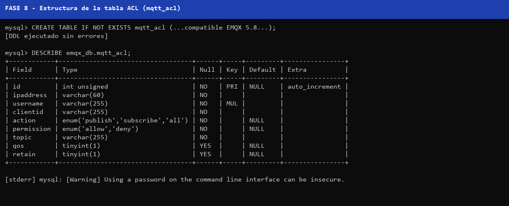
*Figura 6. Estructura de la tabla de reglas ACL (`mqtt_acl`).*

#### 5.1.3.4. Registro del usuario de prueba

Se registró el usuario MQTT exclusivo `lab08_jeanfranco` —sin usar `root`, `admin` ni `emqx_user` como clientes MQTT— con un hash **bcrypt** generado localmente (prefijo `$2b$10$`, longitud 60 caracteres). La contraseña asociada no se almacenó en texto plano ni se incluyó en entregables, capturas ni scripts: únicamente permanece el hash en la base; su (re)generación queda documentada como procedimiento en la entrega para Daniel. La inserción se realizó de forma idempotente y se verificó que exista exactamente un registro, con `is_superuser = 0` y `enabled = 1` (**Figura 7**).

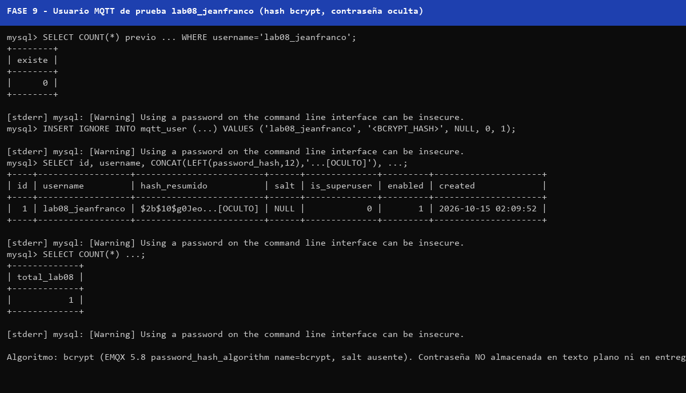
*Figura 7. Usuario MQTT de prueba registrado (hash enmascarado por seguridad).*

#### 5.1.3.5. Registro de reglas ACL

Aplicando el principio de mínimo privilegio, se insertaron dos reglas para `lab08_jeanfranco`: permiso de publicación únicamente en `cistern/LAB08_TEST/telemetry` y permiso de suscripción únicamente bajo `cistern/LAB08_TEST/#` (**Figura 8**). No se otorgaron permisos globales con `#` ni acceso a la telemetría real de los dispositivos del proyecto. Los inserts fueron diseñados como idempotentes mediante cláusulas `WHERE NOT EXISTS`.

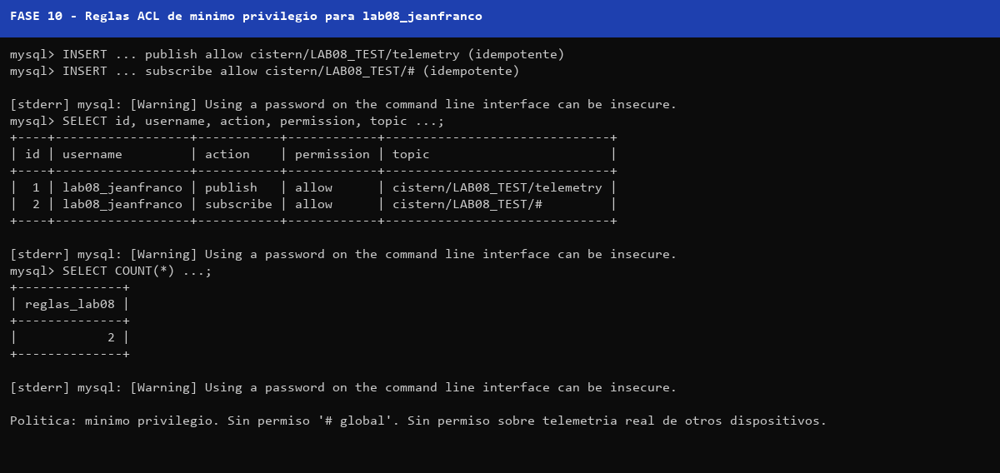
*Figura 8. Reglas ACL registradas para el usuario de prueba.*

#### 5.1.3.6. Verificación mediante phpMyAdmin

La interfaz phpMyAdmin 5.2.3, publicada en `http://localhost:8080` y accesible con las credenciales del despliegue, permitió verificar visualmente la base `emqx_db` con cinco tablas —incluidas `mqtt_user` (1 fila) y `mqtt_acl` (2 filas)—, la estructura de la tabla de usuarios y el contenido de ambas tablas, enmascarando el hash antes de la captura (**Figura 9**).

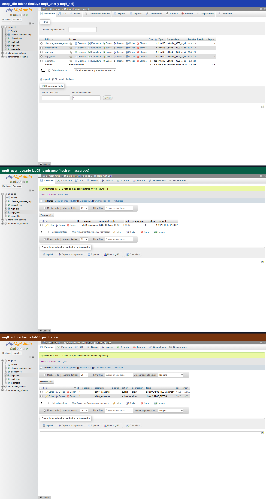
*Figura 9. Verificación de registros mediante phpMyAdmin: estructura de la base, usuario de prueba y reglas ACL.*

#### 5.1.3.7. Verificación SQL

Las consultas de verificación por SQL confirmaron: un único registro de `lab08_jeanfranco` en `mqtt_user`, dos reglas en `mqtt_acl`, ausencia de usernames duplicados y consistencia entre usuarios y permisos (**Figura 10**). Adicionalmente, `SHOW CREATE TABLE` de ambas tablas exhibió las restricciones `PRIMARY KEY` y `UNIQUE KEY mqtt_username`, y el índice `idx_username` (**Figura 11**). El script completo se ejecutó dos veces consecutivas sin duplicar registros ni producir errores, demostrando su idempotencia.

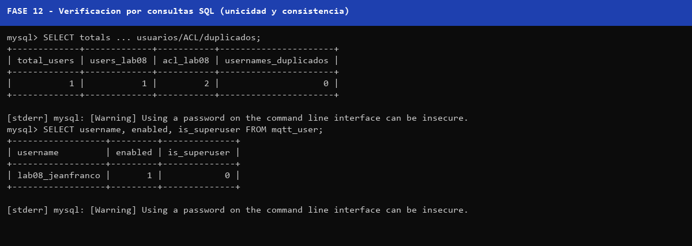
*Figura 10. Verificación mediante consultas SQL (unicidad y consistencia usuario/ACL).*

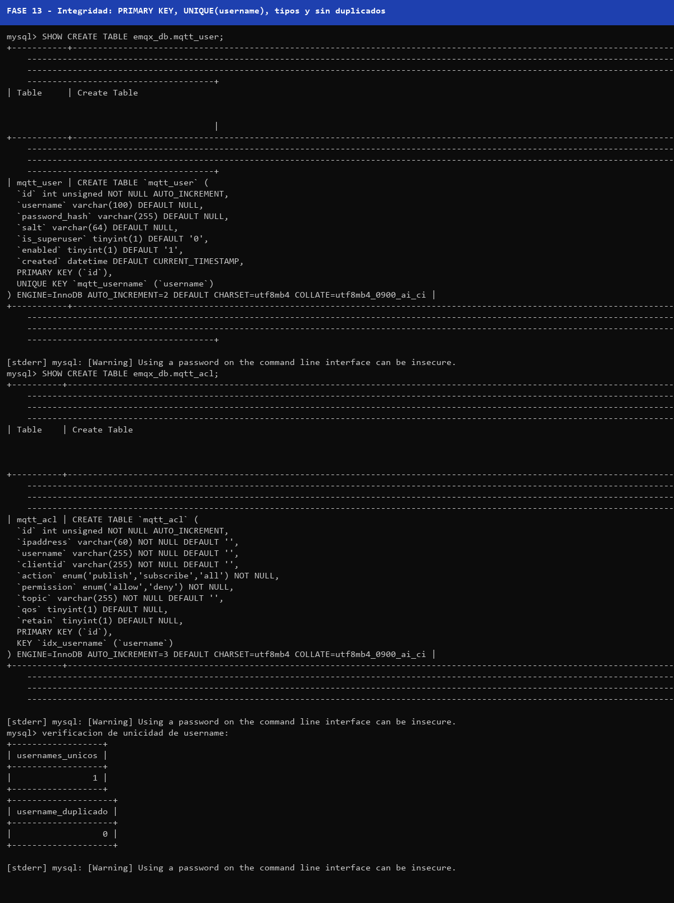
*Figura 11. Prueba de integridad: definiciones `SHOW CREATE TABLE` y restricciones de las tablas preparadas.*

#### 5.1.3.8. Resultados

La matriz completa de pruebas (P01–P12) se encuentra en `MATRIZ_PRUEBAS_JEANFRANCO_LAB08.md`; la totalidad de las pruebas resultó **CONFORME**. El estado final del ecosistema se muestra en la **Figura 12**: los cuatro contenedores permanecen operativos y EMQX 5.8.0 no fue modificado en ninguna de sus configuraciones de autenticación, autorización o conectividad.

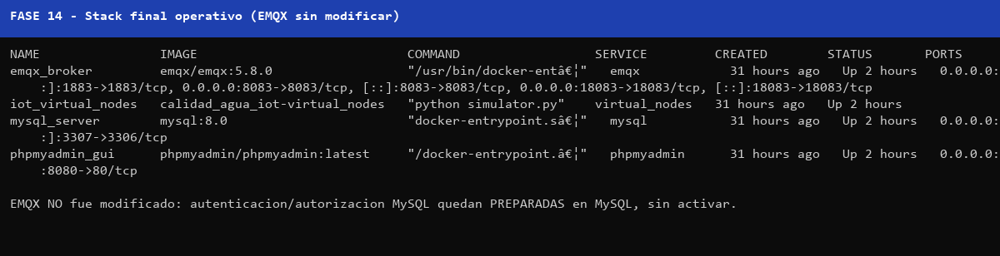
*Figura 12. Estado final de la infraestructura, con EMQX sin modificar.*

#### 5.1.3.9. Conclusiones

1. MySQL 8.0.46 se encuentra plenamente operativo y accesible desde la máquina anfitriona (`localhost:3307`) y desde la red Docker (`mysql_server:3306`), sin requerir cambios en su configuración de red.
2. La base `emqx_db` fue seleccionada y validada como punto único de autenticación/autorización para EMQX, preservando íntegramente las tablas de negocio del proyecto.
3. Las tablas `mqtt_user` y `mqtt_acl` fueron diseñadas conforme a la documentación oficial de EMQX 5.x, con integridad primaria, unicidad de usuarios, índice de búsqueda y hash **bcrypt** para el usuario de prueba `lab08_jeanfranco`.
4. Las reglas ACL de mínimo privilegio quedaron registradas e idempotentemente verificadas, listas para que la etapa de Daniel configure el autenticador y autorizador MySQL en EMQX sin afectar las conexiones anónimas vigentes del Laboratorio 07.
