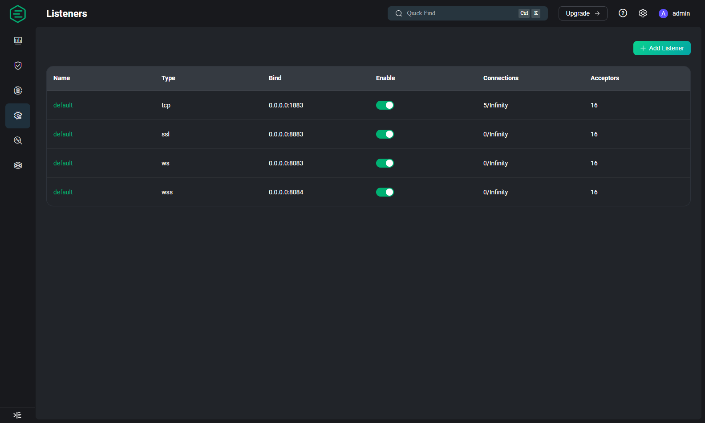
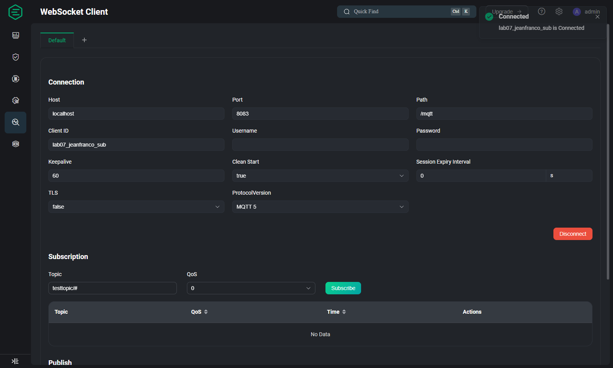
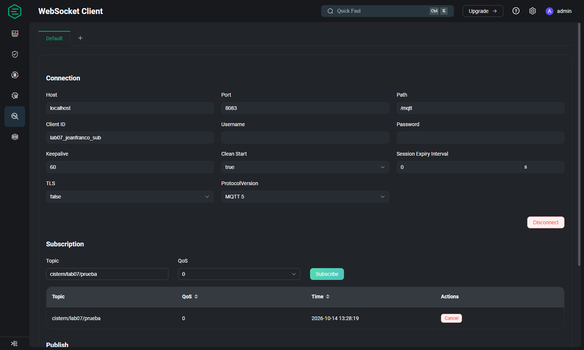
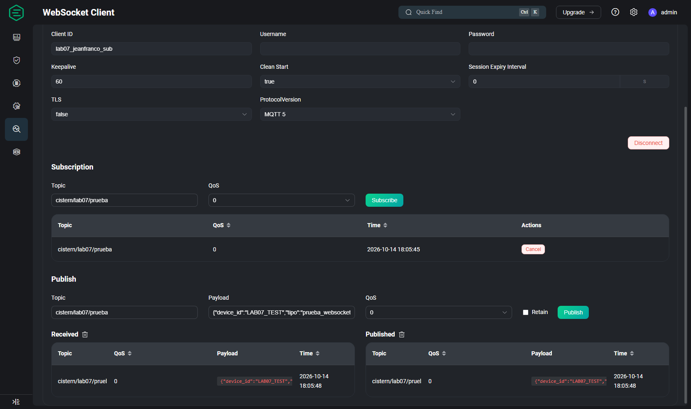
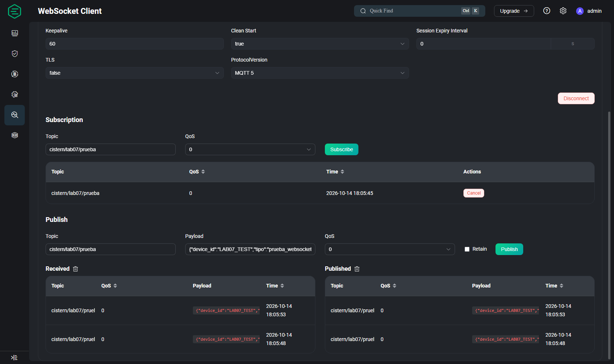
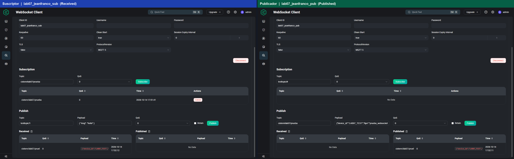
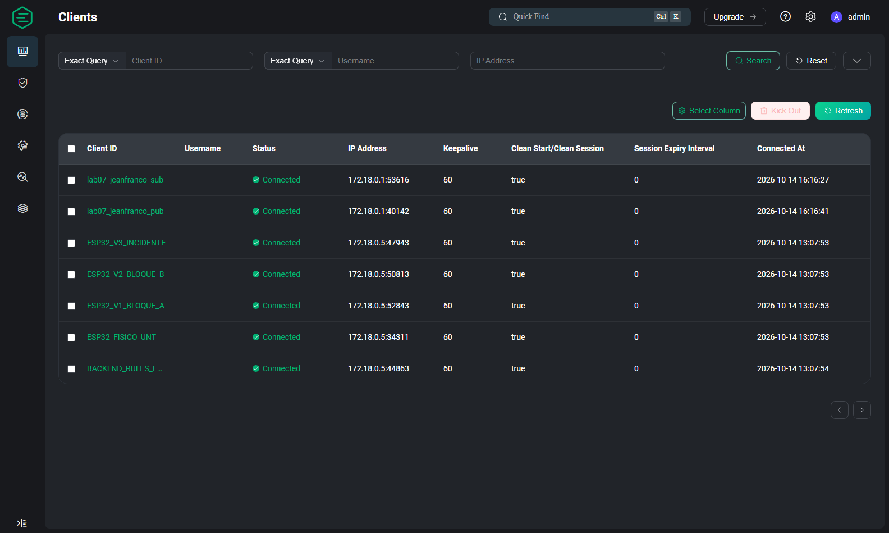
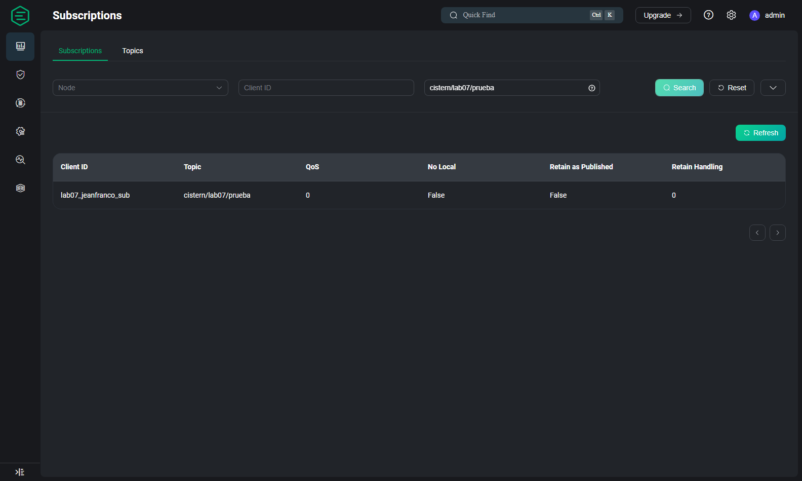
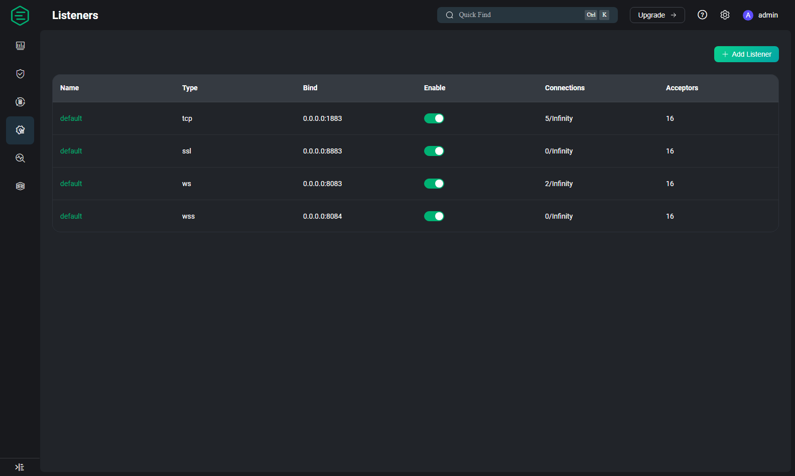
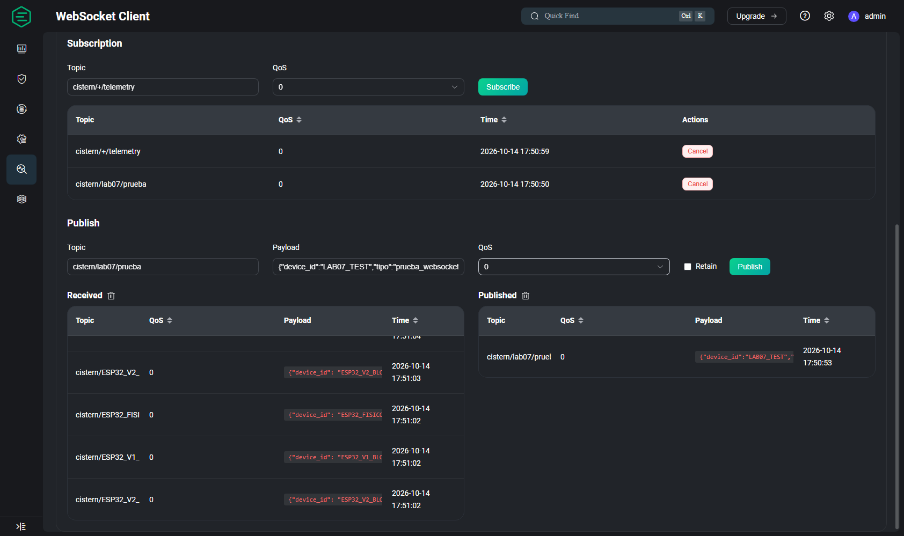

# REDACCIÓN ACADÉMICA PARA EL INFORME DE LABORATORIO 07
**Curso:** Internet de las Cosas  
**Docencia:** Escuela Profesional de Ingeniería de Sistemas — Universidad Nacional de Trujillo  
**Proyecto:** *Monitoreo y predicción de turbidez en tanques de almacenamiento de agua mediante una arquitectura IoT y modelos de regresión*  
**Autor de la Sección:** Jeanfranco  
**Apartado Desarrollado:** 4.1.3  

---

### 4.1.3. Verificación de comunicación MQTT mediante WebSocket

#### 4.1.3.1 Objetivo

El presente apartado tiene por objeto certificar el canal de comunicación MQTT encapsulado sobre WebSocket (MQTT-over-WS) entre clientes web y el broker EMQX 5.8.0 desplegado en la etapa previa. La verificación comprende la conexión, la suscripción a un tópico de prueba aislado, la publicación de una carga útil en formato JSON, la recepción íntegra del mensaje, la coexistencia de dos sesiones WebSocket independientes (publicador y suscriptor), la observación de estos clientes y del tópico en la consola del broker, el registro de conexiones activas en el listener WebSocket y, finalmente, la identificación de solo lectura de la telemetría real generada por los nodos del simulador, dejando documentado el contrato MQTT que regirá la implementación web posterior.

#### 4.1.3.2 Configuración de la conexión

La configuración empleada se resumen en la **Tabla 4.1.3.1**, coherente con el hand-off técnico emitido por la etapa 4.1.2.

**Tabla 4.1.3.1. Parámetros de conexión MQTT sobre WebSocket.**

| Parámetro | Valor |
|---|---|
| Host | `localhost` |
| URL | `ws://localhost:8083/mqtt` |
| Puerto | `8083` |
| Path | `/mqtt` |
| Protocolo | MQTT 5 |
| TLS | Deshabilitado (`false`) |
| Keepalive | 60 s |
| Clean Start | `true` |
| Session Expiry Interval | 0 s |
| Usuario / Contraseña | Vacío (cliente anónimo) |
| Client ID (suscriptor) | `lab07_jeanfranco_sub` |
| Client ID (publicador) | `lab07_jeanfranco_pub` |

Las pruebas se ejecutaron con la herramienta *WebSocket Client* integrada del Dashboard de EMQX (`http://localhost:18083/#/websocket`), la cual expone un formulario con todos los parámetros anteriores. La ausencia de credenciales MQTT demostró que el broker opera en modo anónimo con la política de autorización por defecto, sin necesidad de modificar la configuración del clúster.

#### 4.1.3.3 Conexión mediante WebSocket

Antes de ejecutar las pruebas, se registró el estado baseline del listener WebSocket: `ws:default` vinculado a `0.0.0.0:8083`, habilitado (*Enable* activo) y en estado *Running*, con **0** conexiones activas —condición descrita en el informe de la etapa 4.1.2—, lo que evidencia que el canal estaba disponible pero sin uso (**Figura 4.1.8**).


*Figura 4.1.8. Estado inicial del listener ws:default (0.0.0.0:8083) con el indicador de habilitación activo y cero conexiones.*

Posteriormente, se estableció la conexión con el cliente `lab07_jeanfranco_sub`. El Dashboard emitió la notificación *«lab07_jeanfranco_sub is Connected»* y el botón de la interfaz conmutó a *Disconnect*, confirmando la sesión establecida (**Figura 4.1.9**). La ficha de detalle del cliente en EMQX corroboró formalmente el protocolo **MQTT v5.0** y el listener **`ws:default`** asociado.


*Figura 4.1.9. Cliente lab07_jeanfranco_sub conectado vía ws://localhost:8083/mqtt con los parámetros MQTT 5, keepalive 60 y clean start true.*

#### 4.1.3.4 Suscripción MQTT

El mismo cliente se suscribió al tópico de prueba **`cistern/lab07/prueba`** con QoS 0. Dicho tópico fue diseñado de manera exclusiva para esta validación con el fin de aislar el laboratorio de la telemetría real y evitar interferencias con el motor de reglas. La suscripción quedó activa, representada en la tabla de suscripciones con la acción *Cancel* (**Figura 4.1.10**), y fue confirmada de forma independiente por la API REST del broker (`/api/v5/subscriptions`), que reportó exactamente una suscripción vigente del cliente hacia el tópico con QoS 0.


*Figura 4.1.10. Suscripción activa de lab07_jeanfranco_sub al tópico cistern/lab07/prueba con calidad de servicio 0.*

#### 4.1.3.5 Publicación del mensaje JSON

Se definió una carga útil de laboratorio cuya sintaxis fue validada antes de su envío:

```json
{
  "device_id": "LAB07_TEST",
  "tipo": "prueba_websocket",
  "mensaje": "Prueba MQTT WebSocket exitosa",
  "valor": 25.5,
  "unidad": "NTU",
  "origen": "Jeanfranco",
  "estado": "TEST"
}
```

Se declara expresamente que `LAB07_TEST` no representa un dispositivo físico, que el valor `25.5` no corresponde a una lectura real de turbidez y que el campo `estado: TEST` identifica el mensaje como parte del laboratorio. La publicación se realizó hacia `cistern/lab07/prueba` con QoS 0 y Retain `false`. El mensaje quedó registrado en la tabla *Published* del cliente con su tópico, carga útil completa y marca de tiempo (**Figura 4.1.11**).


*Figura 4.1.11. Registro del mensaje publicado en el tópico de prueba con payload JSON y QoS 0.*

#### 4.1.3.6 Recepción del mensaje

El broker entregó el mensaje a la suscripción activa del mismo cliente, el cual lo registró en su tabla *Received* (**Figura 4.1.12**). La comparación campo a campo entre el payload publicado y el payload recibido arrojó coincidencia total en `device_id`, `tipo`, `mensaje`, `valor`, `unidad`, `origen` y `estado`, demostrando la integridad de la carga útil a través del canal WebSocket sin alteración alguna.


*Figura 4.1.12. Tablas Published y Received del cliente WebSocket con el payload de prueba íntegro en ambos registros.*

#### 4.1.3.7 Prueba con clientes independientes

Para verificar el comportamiento real de publicación y suscripción entre sesiones distintas, se establecieron dos conexiones WebSocket simultáneas con Client ID no reutilizados: `lab07_jeanfranco_sub` (suscriptor) y `lab07_jeanfranco_pub` (publicador). El publicador envió el JSON de prueba al tópico `cistern/lab07/prueba`; el suscriptor independiente lo recibió un segundo después en su tabla *Received*, mientras que el publicador exhibía el mensaje en su tabla *Published* (**Figura 4.1.13**). Esta prueba confirma que el listener WebSocket soporta múltiples sesiones concurrentes y enrutamiento correcto de mensajes entre clientes.


*Figura 4.1.13. Compuesta de ambas sesiones: a la izquierda el suscriptor con el mensaje recibido; a la derecha el publicador con el mensaje enviado.*

#### 4.1.3.8 Verificación de clientes en EMQX

En la sección *Clients* del Dashboard (`#/clients`) se observaron ambos clientes en estado **Connected** con dirección IP `172.18.0.1` (puerto asignado por el anfitrión), keepalive de 60 segundos, Clean Start `true` y Session Expiry `0` (**Figura 4.1.14**). El detalle de sesión del suscriptor y la API REST del broker confirmaron de manera inequívoca el protocolo MQTT v5 y la asociación al listener `ws:default`.


*Figura 4.1.14. Listado de sesiones activas donde lab07_jeanfranco_sub y lab07_jeanfranco_pub aparecen conectados junto a los nodos del simulador.*

#### 4.1.3.9 Verificación de tópicos y listener

La inspección de la sección de suscripciones y tópicos del broker evidenció la existencia de `cistern/lab07/prueba` asociado al cliente `lab07_jeanfranco_sub` con QoS 0 (**Figura 4.1.15**); el CLI interno del nodo listó el mismo tópico como topical local del nodo `emqx@172.18.0.4`. Cabe precisar que, en EMQX 5.8, los tópicos con suscripciones activas se consultan mediante la pestaña *Topics* de la ruta `#/subscriptions`.


*Figura 4.1.15. Tópico cistern/lab07/prueba visible en el broker con su suscriptor asociado.*

Al regresar al panel de listeners con ambas sesiones vivas, el listener `ws:default` reportó **2** conexiones activas sobre `0.0.0.0:8083` (**Figura 4.1.16**), en contraste con las 0 conexiones del estado inicial, corroborándose también vía CLI (`current_conn: 2`) y API REST (`current_connections: 2`).


*Figura 4.1.16. Incremento de conexiones del listener WebSocket de 0 a 2 durante la prueba dual.*

#### 4.1.3.10 Identificación de telemetría

Como fase de observación —sin publicar datos ficticios en tópicos reales— se realizó una suscripción de solo lectura al comodín `cistern/+/telemetry` mediante el mismo canal WebSocket. En la ventana de observación se recibieron mensajes de los nodos `ESP32_FISICO_UNT`, `ESP32_V1_BLOQUE_A` y `ESP32_V2_BLOQUE_B` (**Figura 4.1.17**), con la siguiente estructura real (sin modificaciones):

```json
{"device_id": "ESP32_FISICO_UNT", "location": "Cisterna Comedor UNT", "timestamp": 1792018262, "hardware_health": "OK", "metrics": {"turbidity_ntu": 1.9, "temperature_c": 21.81, "pin_voltage_v": 2.997}}
```

Las claves observadas son `device_id`, `location`, `timestamp` (epoch Unix), `hardware_health` y el objeto `metrics` con `turbidity_ntu` (NTU), `temperature_c` (°C) y `pin_voltage_v` (V). La frecuencia aproximada fue de 5 s para `ESP32_FISICO_UNT`, 3 s para `ESP32_V1_BLOQUE_A` y del orden de 1 s para `ESP32_V2_BLOQUE_B`, el cual opera en régimen intensivo por orden automática del motor de reglas. El nodo `ESP32_V3_INCIDENTE` permaneció sin emisión al estar en estado `STANDBY` decretado por la regla de contingencia, por lo que su tópico de telemetría no produjo mensajes durante la ventana de validación.


*Figura 4.1.17. Mensajes reales recibidos por suscripción de solo lectura al comodín cistern/+/telemetry.*

#### 4.1.3.11 Resultados

El resumen de la matriz de pruebas se presenta a continuación (detalle completo en `MATRIZ_PRUEBAS_JEANFRANCO_LAB07.md`):

| Prueba | Resultado |
|---|---|
| P01 — Listener WebSocket habilitado (8083) | CONFORME |
| P02 — Conexión MQTT sobre WebSocket | CONFORME |
| P03 — Suscripción al tópico de prueba | CONFORME |
| P04 — Publicación del payload JSON | CONFORME |
| P05 — Recepción íntegra del mensaje | CONFORME |
| P06 — Comunicación entre dos clientes independientes | CONFORME |
| P07 — Clientes observados en EMQX (Connected) | CONFORME |
| P08 — Tópico de prueba visible en EMQX | CONFORME |
| P09 — Listener WebSocket con conexiones activas (2) | CONFORME |
| P10 — Identificación de telemetría real (solo lectura) | CONFORME |

Todas las operaciones se ejecutaron sin modificar el simulador, el motor de reglas, la base de datos, la configuración de listeners, la autenticación, las ACL ni el archivo de orquestación Docker.

#### 4.1.3.12 Conclusiones

1. El canal MQTT-over-WebSocket del broker EMQX 5.8.0 se encuentra plenamente operativo en `ws://localhost:8083/mqtt` bajo MQTT 5, habilitando la integración directa de clientes web (frontends y scripts PHP) sin necesidad de intermediarios.
2. El flujo completo conexión → suscripción → publicación → recepción fue validado con éxito, demostrando integridad de carga útil JSON y comportamiento correcto del broker en QoS 0, Retain `false` y sesiones efímeras (`Clean Start=true`, `Session Expiry=0`).
3. La coexistencia de dos sesiones WebSocket independientes con enrutamiento correcto PUB→SUB confirma la idoneidad del listener para la arquitectura cliente-servidor prevista en el proyecto.
4. La telemetría real del sistema fue identificada bajo la taxonomía `cistern/<device_id>/telemetry` con la estructura de campos documentada, quedando el contrato MQTT y los parámetros de conexión formalmente entregados al integrante Daniel para la construcción de `publicacion.php` y `suscritor.php`.
